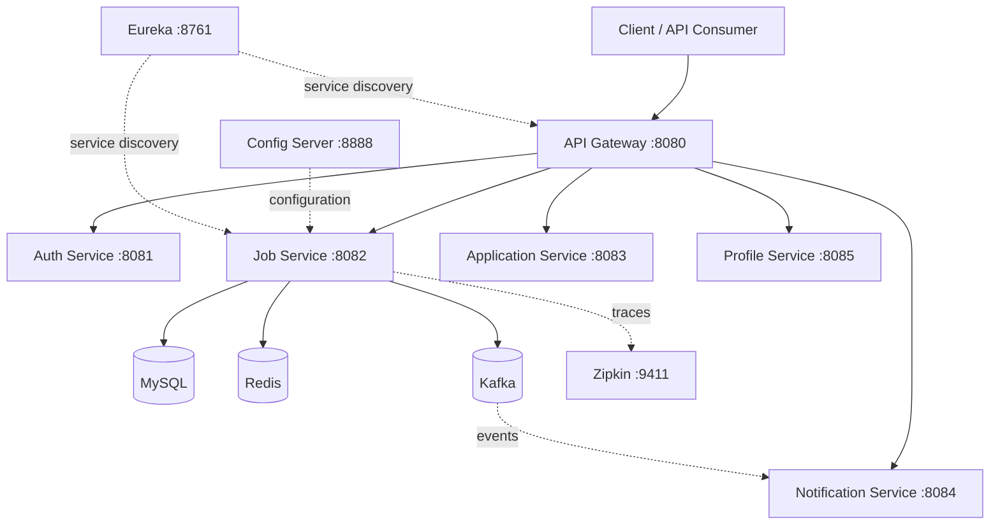

# Project Express

**A Spring Boot microservices-based job application platform**

Project Express is a backend-focused personal project exploring how independent services collaborate in a job application system. It brings together authentication, job management, applications, profiles, and notifications, with service discovery, centralized configuration, containerization, and a Jenkins CI pipeline.

> **Project status:** Local microservices development and Docker-based setup are in progress. The Jenkins pipeline has successfully completed source checkout, Maven packaging, unit tests, and Docker image creation for **Job Service**. A Docker Compose deployment stage has been configured but **not yet verified**. Kubernetes deployment is **not yet implemented for this project**.

## Technology Stack

| Area | Technologies |
| --- | --- |
| Language and framework | Java 25, Spring Boot 4.1.1 |
| Security | Spring Security, JWT |
| Microservices infrastructure | Spring Cloud Config Server, Eureka Discovery Server, Spring Cloud API Gateway |
| Persistence | MySQL, Spring Data JPA / Hibernate |
| Messaging and caching | Apache Kafka, Redis |
| Observability | Zipkin |
| Object storage | SeaweedFS (S3-compatible) |
| Build and testing | Maven Wrapper, JUnit / Spring Boot tests |
| Containers and automation | Docker, Docker Compose, Jenkins, GitHub |

## Architecture



*The diagram illustrates the intended logical architecture; it is not a claim that every route, event flow, or integration has been end-to-end verified.*

## Services

| Component | Local port | Responsibility |
| --- | ---: | --- |
| API Gateway | 8080 | Entry point and routing |
| Auth Service | 8081 | Authentication and JWT-related functionality |
| Job Service | 8082 | Job-related backend functionality |
| Application Service | 8083 | Job application functionality |
| Notification Service | 8084 | Notification-related functionality |
| Profile Service | 8085 | Profile-related functionality |
| Eureka Discovery Server | 8761 | Service registration and discovery |
| Spring Cloud Config Server | 8888 | Centralized application configuration |
| Kafka | 9092 | Event messaging |
| Redis | 6379 | Caching / data access support |
| Zipkin | 9411 | Distributed tracing |
| SeaweedFS S3 endpoint | 8333 | S3-compatible object storage |

Ports describe the project's local configuration. Actual availability depends on which services are running.

## Repository Layout

The repository contains separate Spring Boot services and infrastructure configuration. Important paths include:

```text
project-express/
├── Jenkinsfile
├── docker-compose.yml
├── job-service/
│   └── job-service/
│       ├── Dockerfile
│       ├── mvnw.cmd
│       ├── pom.xml
│       └── src/
└── ... other microservices and configuration ...
```

## Local Setup

### Prerequisites

- JDK 25
- Docker Desktop with the Linux container engine
- MySQL accessible on the host, if using the current Compose database configuration
- Maven Wrapper (included with the services)

### Configure environment variables

The Docker Compose setup references these variables:

```dotenv
DB_USERNAME=your_mysql_username
DB_PASSWORD=your_mysql_password
JWT_SECRET=replace_with_a_long_random_secret
```

Place the values in a local `.env` file alongside `docker-compose.yml`, or supply them securely as environment variables. **Never commit real credentials, JWT secrets, or `.env` files.**

### Build Job Service

From the repository root in Windows PowerShell:

```powershell
cd .\job-service\job-service
.\mvnw.cmd clean package "-DskipTests"
```

### Build the Job Service Docker image

From the same Job Service directory:

```powershell
docker build -t project-express/job-service:latest .
```

The Dockerfile uses `eclipse-temurin:25-jre` and copies the Maven-generated JAR from `target/`.

### Docker Compose

Return to the repository root and validate the configuration:

```powershell
cd ..\..
docker compose config --quiet
```

The Compose file defines Job Service with the image `project-express/job-service:latest`. Start only the components you intend to use, and ensure their dependencies are available. For example, to start **only** Job Service without automatically starting dependencies:

```powershell
docker compose up -d --no-deps --no-build job-service
```

> Job Service requires supporting infrastructure such as Config Server, Eureka, Kafka, Redis, and MySQL. The command above does **not** start those dependencies, so it is not a complete standalone startup procedure.

## Jenkins CI/CD

The repository contains a declarative `Jenkinsfile` with these stages:

1. **Checkout** — retrieve source from GitHub.
2. **Build Job Service** — package the Spring Boot application using Maven.
3. **Run Unit Tests** — execute the Job Service tests.
4. **Build Docker Image** — create `project-express/job-service:latest`.
5. **Deploy Job Service** — configured to recreate the Job Service container with Docker Compose; **not yet verified**.

The first four stages have been successfully executed in Jenkins. The deployment stage uses:

```powershell
docker compose up -d --no-deps --force-recreate --no-build job-service
```

Jenkins credentials are referenced by ID rather than hardcoded into the repository:

- `project-express-db-username`
- `project-express-db-password`
- `project-express-jwt-secret`

The current Jenkins setup is local and has been triggered manually with **Build Now**. Automatic GitHub-push triggering has not yet been configured or verified.

## Current Progress

| Area | Status |
| --- | --- |
| Spring Boot microservices and supporting infrastructure | Implemented locally; integration work ongoing |
| Docker images and Docker Compose configuration | Available |
| Jenkins checkout, Maven build, unit tests | Verified successful for Job Service |
| Jenkins Docker image build | Verified successful for Job Service |
| Jenkins Docker Compose deployment | Configured, not yet verified |
| Kubernetes deployment for Project Express | Planned / learning |

## Next Improvements

- Verify Jenkins-driven Docker Compose deployment and application health checks.
- Add a reliable local startup sequence and dependency readiness checks.
- Expand automated integration tests across services.
- Introduce Kubernetes Deployments, Services, ConfigMaps, and Secrets.
- Configure a container registry and versioned image tags for a fuller deployment pipeline.

## Author

**Simanta Paul**  
GitHub: [@simantapaul06](https://github.com/simantapaul06)

---

*This repository is a hands-on learning and portfolio project. Features and deployment stages are documented according to their current implementation and verification status.*
